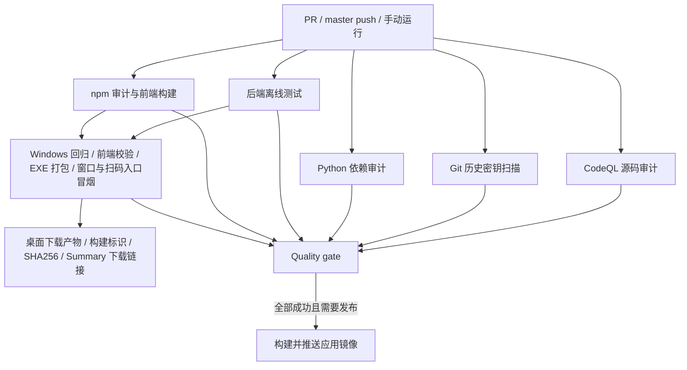

# CI 代码审计与镜像发布

入口：`.github/workflows/docker-image.yml`，Actions 名称为 **CI, Desktop & Docker Build**。

## 触发与发布

- 向 `master` / `main` 提交 PR：审计、测试、前端构建及 Windows EXE 打包，保存 `frontend-dist` 和 `GoofishMonitor-Windows-x64` 下载产物。
- 推送到 `master` / `main` 或 `v*` 标签：重新检查实际提交，全部通过后发布 amd64/arm64 镜像。
- 手动运行：始终执行检查和 Windows 打包，通过 `publish_docker` 选择是否发布镜像。取消该选项仍可下载桌面版。
- 不设置路径过滤，避免只改工作流或依赖时漏掉检查。同一 PR 的新运行取消旧运行；同一分支的发布运行串行执行。



## 审计内容与阻断规则

| 检查 | 范围 | 阻断条件 |
| --- | --- | --- |
| CodeQL `security-extended` | Python、JavaScript/TypeScript、GitHub Actions | 安全评分 ≥ 7.0；无评分但级别为 error；报告缺失、损坏或扫描执行失败 |
| Gitleaks | 获取的全部 Git 历史 | 检出密钥，或扫描/下载/校验失败 |
| pip-audit | `requirements-runtime.txt` 及解析出的间接依赖 | 任意已知漏洞，或依赖解析/漏洞查询失败 |
| npm audit | `web-ui/package-lock.json`，包含开发与构建依赖 | high/critical 漏洞（下述精确例外除外），或审计请求失败 |
| pytest | 除 `tests/audit` 外的测试，排除 live/live_slow | 任意用例失败或测试无法执行 |
| Vue 构建 | 锁定依赖安装、TypeScript 检查、Vite 构建 | 任一步失败 |
| Windows 打包 | 同提交前端校验、Windows 回归、PyInstaller、HTTP/原生窗口/扫码入口冒烟、产物整理 | 任一步失败；未通过冒烟不上传桌面下载包 |

CodeQL 完成分析和上传告警本身不代表没有高危问题，因此额外执行 `scripts/ci/check_codeql.py` 读取 SARIF 并返回失败状态。关卡不使用漏洞基线自动放行，也不通过 `continue-on-error` 隐藏扫描失败。

`Quality gate` 要求所有上游 job 都返回 success；failure、cancelled、skipped 均不允许发布。`publish-docker` 依赖此关卡，Docker 构建或发布失败也会如实显示失败。

桌面产物的构建和上传依赖后端测试、前端构建及 Windows 自身检查；它在其他审计全部完成之前可能已经可下载，不能把“存在桌面 Artifact”等同于所有安全审计通过。使用前查看 Quality gate。打包步骤与下载方式详见 [桌面版文档](DESKTOP.md#自动化流水线)。

### 前端依赖例外（2026-10-22 审查）

更新锁文件至修补版本后，Tailwind CSS 3 的间接构建依赖 `braces` 仍受 [GHSA-vfj7-8cjw-p6xm](https://github.com/advisories/GHSA-vfj7-8cjw-p6xm) 影响，上游尚无修复版本。漏洞由恶意嵌套 glob 模式触发；本项目构建仅使用仓库维护的 Tailwind 内容路径，不接受用户提交 glob，生产静态资源不运行 braces。

`scripts/ci/check_npm_audit.py` 只在该漏洞编号、包名和 high 等级均匹配，且锁文件中每个受影响节点都为 `dev: true` 时放行，复审截止 **2026-11-22**。过期、进入运行时依赖、其他漏洞或 critical 等级均阻断。保留完整 npm JSON 报告；网络错误、缺失或无效报告不能通过。修复版本发布后应更新锁文件并删除例外。

Gitleaks 8.24.2 不支持 `--timeout`；超时通过扫描 step 的 `timeout-minutes: 5` 控制，扫描使用 `--exit-code 1`。不以 `|| true` 掩盖扫描失败。

## 查看报告

- Actions 运行页的 **Artifacts**：按语言保存 CodeQL SARIF，以及 Gitleaks、pip-audit、npm audit 的 JSON 和 pytest JUnit 报告，保留 14 天；扫描失败时仍尝试保存已生成的报告。
- 仓库 **Security → Code scanning**：查看 CodeQL 告警、规则与代码位置。
- **Quality gate → Summary**：查看各检查的最终状态。

密钥扫描使用 `--redact=100`，不在日志和扫描报告里输出匹配到的密钥原文。不要将真实 `.env`、cookies 或运行数据提交到 Git。若测试数据等存在误报，可在 `.gitleaksignore` 中记录对应的指纹进行豁免。

已核实的历史示例：提交 `2c4b6a4b7508f92f7f34dd60202396dd8b04524e` 中 `AUTH_README.md` 的 localhost curl 请求使用项目公开的默认 `admin/admin123`，命中 `curl-auth-user`。报告起始行为 77（注释），curl 示例在 78 行。仅在 `.gitleaksignore` 中豁免该提交、路径、规则和行号的完整指纹，不豁免整个文件或规则。文件已删除仍会被全历史扫描检出，因此重新运行旧提交不会应用此修复，必须检查包含本次修改的新提交。

## 权限与仓库设置

工作流默认仅 `contents: read`，checkout 不保存凭据。CodeQL job 单独使用 `security-events: write` 上传告警；只有发布 job 具有 `packages: write`。审计无需额外 AI API Key 或第三方审计服务密钥。CodeQL Action 固定为已使用过的 v4.39.1 完整提交 SHA，Gitleaks 下载固定版本并校验发布方 checksum。

当前仓库为公开仓库，可使用 CodeQL。如果迁移到私有仓库，需要确认 GitHub Code Security 授权。仓库已有 CodeQL Default setup 时，应先关闭 Default setup，再使用这份 Advanced setup 工作流，避免结果上传冲突。

若还需要**禁止未通过审计的 PR 合并**，在 `master` 的 Ruleset/Branch protection 中将 **Quality gate** 设置为必需状态检查。工作流本身负责阻止镜像发布，不会自动改动仓库分支保护规则。

## 本地复现

```bash
python -m pip install -r requirements.txt -r requirements-audit.txt
python -m pytest --ignore=tests/audit -m 'not live and not live_slow'
python -m pytest tests/unit/test_codeql_gate.py
mkdir -p reports
python -m pip_audit -r requirements-runtime.txt --strict --format json --output reports/pip-audit.json
cd web-ui
npm audit --package-lock-only --audit-level=high
npm ci --no-audit --no-fund
npm run build
```

需要应用上述精确例外时，先将 `npm audit --package-lock-only --json` 输出保存为 `reports/npm-audit.json`，再从仓库根目录执行 `python scripts/ci/check_npm_audit.py reports/npm-audit.json web-ui/package-lock.json`。原始 `npm audit` 会继续报告已知的 braces 漏洞。

下载 CodeQL SARIF 后，可在仓库根目录运行：

```bash
python scripts/ci/check_codeql.py reports/codeql --min-score 7.0
```

Windows 已移除模块导入时的标准输出 `detach()`，并将熔断状态锁迁移到独立锁文件；常规 `pytest` 可直接运行，CI 不跳过这些用例。

Python 运行时依赖目前未锁版本，pip-audit 检查本次解析的版本，不能证明后来重新安装的依赖仍是同一版本；要保证部署依赖完全可复现，还需单独引入依赖锁定。静态审计与依赖库也不能替代业务权限检查或真实浏览器任务验证。

参考：[CodeQL Action](https://github.com/github/codeql-action)、[pip-audit](https://github.com/pypa/pip-audit)、[npm audit](https://docs.npmjs.com/cli/v11/commands/npm-audit/)、[Gitleaks](https://github.com/gitleaks/gitleaks)。
