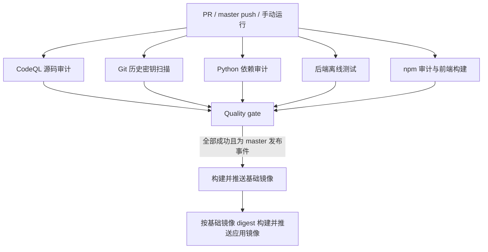

# CI 代码审计与镜像发布

入口：`.github/workflows/docker-image.yml`，Actions 名称为 **CI, code audit and Docker release**。

## 触发与发布

- 向 `master` 提交 PR：审计、测试和前端构建，不登录镜像仓库、不发布镜像。
- 推送或合并到 `master`：重新检查实际提交，全部通过后发布 amd64/arm64 镜像。
- 手动运行：始终执行检查，只有选中 `master` 才允许发布。
- 不设置路径过滤，避免只改工作流或依赖时漏掉检查。同一 PR 的新运行取消旧运行；同一分支的发布运行串行执行。



## 审计内容与阻断规则

| 检查 | 范围 | 阻断条件 |
| --- | --- | --- |
| CodeQL `security-extended` | Python、JavaScript/TypeScript、GitHub Actions | 安全评分 ≥ 7.0；无评分但级别为 error；报告缺失、损坏或扫描执行失败 |
| Gitleaks | 获取的全部 Git 历史 | 检出密钥，或扫描/下载/校验失败 |
| pip-audit | `requirements-runtime.txt` 及解析出的间接依赖 | 任意已知漏洞，或依赖解析/漏洞查询失败 |
| npm audit | `web-ui/package-lock.json`，包含开发与构建依赖 | high/critical 漏洞，或审计请求失败 |
| pytest | 除 `tests/audit` 外的测试，排除 live/live_slow | 任意用例失败或测试无法执行 |
| Vue 构建 | 锁定依赖安装、TypeScript 检查、Vite 构建 | 任一步失败 |

CodeQL 完成分析和上传告警本身不代表没有高危问题，因此额外执行 `scripts/ci/check_codeql.py` 读取 SARIF 并返回失败状态。关卡不使用漏洞基线自动放行，也不通过 `continue-on-error` 隐藏扫描失败。

`Quality gate` 要求所有上游 job 都返回 success；failure、cancelled、skipped 均不允许发布。两个镜像发布 job 依赖此关卡。应用镜像通过基础镜像的 `sha256` digest 引用同次运行的构建结果，避免使用浮动 latest 产生串用。

## 查看报告

- Actions 运行页的 **Artifacts**：按语言保存 CodeQL SARIF，以及 Gitleaks、pip-audit、npm audit 的 JSON 和 pytest JUnit 报告，保留 14 天；扫描失败时仍尝试保存已生成的报告。
- 仓库 **Security → Code scanning**：查看 CodeQL 告警、规则与代码位置。
- **Quality gate → Summary**：查看各检查的最终状态。

密钥扫描使用 `--redact=100`，不在日志和扫描报告里输出匹配到的密钥原文。不要将真实 `.env`、cookies 或运行数据提交到 Git。

## 权限与仓库设置

工作流默认仅 `contents: read`，checkout 不保存凭据。CodeQL job 单独使用 `security-events: write` 上传告警；只有两个发布 job 具有 `packages: write`。审计无需额外 AI API Key 或第三方审计服务密钥。Action 使用已核对的完整提交 SHA，Gitleaks 下载固定版本并校验发布方 checksum。

当前仓库为公开仓库，可使用 CodeQL。如果迁移到私有仓库，需要确认 GitHub Code Security 授权。仓库已有 CodeQL Default setup 时，应先关闭 Default setup，再使用这份 Advanced setup 工作流，避免结果上传冲突。

若还需要**禁止未通过审计的 PR 合并**，在 `master` 的 Ruleset/Branch protection 中将 **Quality gate** 设置为必需状态检查。工作流本身负责阻止镜像发布，不会自动改动仓库分支保护规则。

## 本地复现

```bash
python -m pip install -r requirements.txt -r requirements-audit.txt
python -m pytest --ignore=tests/audit -m 'not live and not live_slow'
python -m pytest tests/unit/test_codeql_gate.py
mkdir -p reports
python -m pip_audit -r requirements-runtime.txt --strict --format json --output reports/pip-audit.json
cd web-ui
npm audit --package-lock-only --audit-level=high
npm ci --no-audit --no-fund
npm run build
```

下载 CodeQL SARIF 后，可在仓库根目录运行：

```bash
python scripts/ci/check_codeql.py reports/codeql --min-score 7.0
```

Windows 当前标准输出初始化与 pytest 捕获不兼容时，使用 `pytest -s`。现有 `FailureGuard` 测试还受 Windows 打开文件时无法原子替换的行为影响；CI 使用 Linux，不跳过这些用例。

Python 运行时依赖目前未锁版本，pip-audit 检查本次解析的版本，不能证明后来重新安装的依赖仍是同一版本；要保证部署依赖完全可复现，还需单独引入依赖锁定。静态审计与依赖库也不能替代业务权限检查或真实浏览器任务验证。

参考：[CodeQL Action](https://github.com/github/codeql-action)、[pip-audit](https://github.com/pypa/pip-audit)、[npm audit](https://docs.npmjs.com/cli/v11/commands/npm-audit/)、[Gitleaks](https://github.com/gitleaks/gitleaks)。
