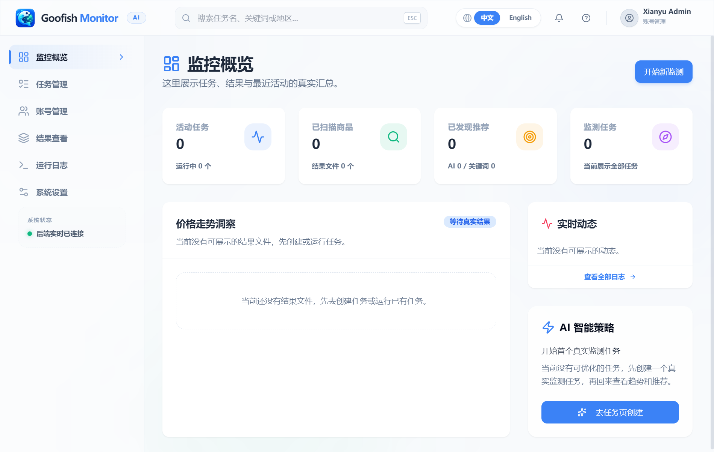

# Windows 桌面版

双击 `GoofishMonitor.exe` 即可打开独立桌面窗口，无需启动 Python 或浏览器。窗口支持缩放、最小化和最大化；顶部、登录页、任务栏和托盘使用统一的小鱼雷达图标。

关闭窗口会隐藏到系统托盘，监控和定时任务继续运行。单击托盘图标或选择“打开主窗口”恢复；选择“退出并停止监控”会关闭应用、停止调度和爬虫进程。若托盘未能初始化，关闭窗口会直接退出，避免程序隐藏后无法恢复。

## 运行环境与数据

- 支持 Windows 10/11 x64，界面使用 Microsoft Edge WebView2 Runtime。通常系统已有该组件；缺少时请从 [Microsoft 官方页面](https://developer.microsoft.com/microsoft-edge/webview2/) 安装 Evergreen Runtime。它与抓取闲鱼所需的浏览器环境是两项独立要求。
- 默认数据目录为 `%LOCALAPPDATA%\GoofishMonitor`，保留旧桌面版的配置、账号和结果；可用 `GOOFISH_DATA_DIR` 指定其他绝对目录。
- 桌面版只监听 `127.0.0.1`，自动预留空闲端口。同一数据目录只允许一个桌面实例，重复打开时请从托盘恢复现有窗口。登录鉴权继续保留。
- 桌面日志位于数据目录的 `logs/desktop.log`；界面缓存位于 `desktop-profile/`，不要共享或提交该目录。不要在同一数据库上同时启动旧版和新版程序。
- `--no-browser` 保留原来的纯本地服务模式；`--browser` 使用外部浏览器。普通 Web/Docker 入口保持不变。
- 闲鱼登录、抓取和真实 AI 分析仍需配置对应账号和服务。程序未签名，当前交付为便携 EXE；不包含安装向导、自动更新或系统自启动。

## 本地构建

```powershell
python -m pip install -r requirements-desktop.txt
cd web-ui
npm ci
npm run build
cd ..
python -m PyInstaller --noconfirm --distpath audit/desktop/dist --workpath audit/desktop/build desktop.spec
python scripts/ci/check_desktop_smoke.py audit/desktop/dist/GoofishMonitor.exe --native --report audit/desktop/gui.json
```

打包只包含公开资源、默认提示词和 `.env.example`，不包含个人配置、密钥、登录状态或数据库。EXE 位于 `audit/desktop/dist/GoofishMonitor.exe`。

## 自动化流水线

`.github/workflows/docker-image.yml` 在推送 master/main、`v*` 标签、对应分支的 PR 和手动触发时执行。新增 Windows job 复用已通过构建的前端产物，在 Python 3.12 下运行离线测试、打包无控制台 EXE，并验证后台服务及真实桌面窗口、托盘和退出清理。

成功后可从该次 Actions 的 Artifacts 下载 `GoofishMonitor-Windows-x64`，包含 EXE、本文和 SHA256 校验文件；`windows-desktop-validation` 保存测试报告和原生界面截图。PR 也可获取构建产物，不需要发布权限；此流程不自动创建 GitHub Release。推送远程后才能在 GitHub 执行，本地修改不会自动触发远程流水线。

## 本轮验证与界面

Windows / Python 3.12 的 319 项离线回归通过，3 项真实服务测试排除；前端类型检查、生产构建与 2 项前端回归通过。源代码原生窗口冒烟已验证登录、图标、托盘隐藏/恢复和退出时关闭后台服务。

PyInstaller 实际打包及最终无控制台 EXE 的同组冒烟均通过，产物约 71.5 MiB。流水线 YAML 已解析检查，远程 Actions 尚未触发。



界面容器与主线程约束参考 [pywebview 文档](https://pywebview.flowrl.com/guide/usage.html)；Windows 渲染环境参考 [Web engine 文档](https://pywebview.flowrl.com/guide/web_engine.html)；托盘行为参考 [pystray 文档](https://pystray.readthedocs.io/en/latest/usage.html)。

## 图标来源

使用内置 imagegen 生成原创位图，源文件为 `assets/desktop/goofish.png`。`goofish.ico` 包含 16–256 像素多种尺寸；前端使用 `web-ui/public/app-icon.png`。格式转换保留透明通道。完整生成提示词见同目录 `ICON_PROMPT.md`。
