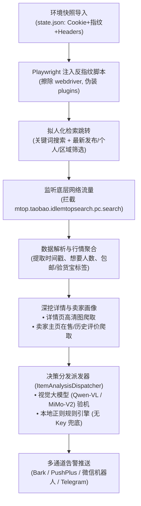

# 闲鱼 AI 二手监控系统：全景体检、缺陷追踪与优化推进总览

> **文档状态**：持续更新中  
> **当前基线**：Commit `46bb780`（已完成 Windows 浏览器残留治理与启动互斥）  
> **报告汇总日期**：2026-10-22  
> **适用环境**：Windows 10/11 个人电脑本地运行、Docker 及桌面打包发布  

---

## 一、 系统定位与架构全景

### 1.1 业务核心定位
本项目并非追求“0.1 秒逆向抢单”（此类工具极易触发阿里顶层风控导致封号），而是专为普通买家打造的 **“AI 二手验货师与全天候避坑质检顾问”**：
- **普通买家避坑**：识别成色暗病、翻新机、组装机，识破伪装成个人的二手贩子与诈骗话术；
- **全网行情对齐**：自动聚合商品 30 天历史交易价格，计算中位数与价格分位数，评估是否虚高或性价比极佳；
- **7×24 小时低频巡逻**：采用拟人化操作机制，长效稳定监控，及时推送微信、Bark、钉钉等通知。

### 1.2 核心技术链路

---

## 二、 缺陷体检排查与完整诊断矩阵（共 20 项）

经全量源码审计与 15 组离线隔离测试复现，系统缺陷涵盖**安全漏洞、Windows 平台兼容、数据一致性、风控防封号、资源治理**五个维度：

### 缺陷清单与优先级矩阵

| 编号 | 分级 | 缺陷主题 | 核心成因与危害 | 当前状态 | 涉及核心文件 |
| :--- | :---: | :--- | :--- | :---: | :--- |
| **F01** | **P1** | **Windows 停止任务残留浏览器孤儿进程** | `process.terminate()` 仅杀 Python，底层 Edge/Chromium 进程树遗留吃满内存 | **已修复 (Commit 46bb780)** | `src/services/process_service.py` |
| **F02** | **P1** | **调试 `input()` 挂起阻塞** | `debug_limit` 模式无终端时挂起或抛 `EOFError`，阻断 `browser.close()` 执行 | **已修复 (Commit 46bb780)** | `src/scraper.py` |
| **F03** | **P1** | **同一任务并发重复启动** | 异步检查与注册之间存在时间窗口，并发请求拉起重复子进程 | **已修复 (Commit 46bb780)** | `src/services/process_service.py` |
| **A01** | **P0** | **后端 API 与 WebSocket 全量无鉴权** | 前端仅靠 localStorage 存登录态，后端接口全裸奔，可直接下载闲鱼 Cookie | **待修复** | `src/app.py` `src/api/routes/accounts.py` |
| **A02** | **P0** | **任务名称路径遍历导致任意目录被删除** | 临时图片目录直接拼接 `task_name`，未校验 `..`，清理时 `shutil.rmtree` 越界 | **待修复** | `src/ai_handler.py` |
| **A09** | **P0** | **AI 测试接口转发存储的 API Key (SSRF)** | 未带 Key 时调用系统 Key，但允许指定任意 `base_url`，导致真实 Key 被盗取 | **待修复** | `src/api/routes/settings.py` |
| **A11** | **P0** | **Windows 下熔断文件写回权限拒绝 (WinError 5)** | 文件处于 `open(..., 'a+')` 打开状态时执行 `os.replace`，Windows 必崩 | **待修复** | `src/failure_guard.py` |
| **A12** | **P0** | **模块导入 detach 标准输出破坏环境** | `ai_handler.py` 顶层无条件 `sys.stdout.detach()`，测试报错退出码 120，无窗口闪退 | **待修复** | `src/ai_handler.py` |
| **A03** | **P1** | **启停任务状态清空绑定的专属闲鱼账号** | `TaskUpdate` 预处理无脑写入 `None` 和 `auto`，更新状态时原绑定账号被抹除 | **待修复** | `src/domain/models/task.py` |
| **A04** | **P1** | **并发创建任务主键冲突覆盖** | `SELECT MAX(id)+1` 无锁，并发创建时 `INSERT OR REPLACE` 静默覆盖丢失任务 | **待修复** | `sqlite_task_repository.py` |
| **A06** | **P1** | **AI 判定标准文件同关键词串用与误删** | 标准文件仅按关键词命名，多任务互相覆盖；生成异常时回滚误删旧任务文件 | **待修复** | `task_generation_runner.py` |
| **A07** | **P1** | **同关键词任务互相遮蔽，通知重复触发** | 去重键未关联 `task_id`，同关键词不同规则任务漏报；保存后未校验成功即发通知 | **待修复** | `scraper.py` `item_analysis_dispatcher.py` |
| **A13** | **P1** | **启动爬虫按名称传参，重名任务执行错乱** | 子进程仅接收 `--task-name`，CLI 取第一条匹配项，导致执行配置完全错位 | **待修复** | `spider_v2.py` `process_service.py` |
| **A14** | **P1** | **详情页风控异常被吞导致闲鱼封号** | 遇到滑块验证（`FAIL_SYS_USER_VALIDATE`）抛出的异常被通用 `except` 吞掉硬爬 | **待修复** | `src/scraper.py` |
| **F04** | **P1** | **缺少全局浏览器并发上限控制** | Web 与 CLI 独立启动多个子进程，任务多时同时弹出大量浏览器吃爆 CPU | **待修复** | `spider_v2.py` `process_service.py` |
| **A08** | **P2** | **流式图片下载正文在事件循环中阻塞读取** | `requests.get(stream=True)` 后 `iter_content` 运行在主事件循环线程中 | **待修复** | `src/ai_handler.py` |
| **A10** | **P2** | **CSV 导出未过滤公式前缀注入** | 外部传入的商品标题（如 `=HYPERLINK`）未做转义直接写入 CSV 单元格 | **待修复** | `result_export_service.py` |
| **A15** | **P2** | **桌面单文件打包子进程重新启动主程序** | `_MEIPASS` 临时资源目录持久化丢失，且 `sys.executable` 误当成 Python 解释器 | **待优化** | `desktop_launcher.py` |
| **A16** | **P2** | **结果查询与价格历史全量加载内存** | 翻页未下推到 SQL，历史快照全量进内存计算，长期运行内存持续增长 | **待优化** | `result_storage_service.py` `price_history_service.py` |
| **F05** | **P2** | **残留临时图片未建立定期过期淘汰机制** | 强制终止或异常中断遗留的图片未设置定时清理巡检策略 | **待优化** | `item_analysis_dispatcher.py` |

---

## 三、 已完成优化与落地进展 (Commit `46bb780`)

针对前期对个人电脑运行影响最大的 **“Windows 浏览器残留与内存泄露”** 问题，已成功完成治理：

### 3.1 改造亮点
1. **Windows 异步级联树形强杀**：
   - 在 `src/services/process_service.py` 中引入 `_kill_process_tree_windows`；
   - 当任务停止或超时退出时，调用 Windows 原生 `taskkill /F /T /PID <pid>`（`/T` 参数强制连带终结指定进程派生的全部子进程树）；
   - 彻底消除了 Playwright 底层 `msedge.exe` / `chromium.exe` 孤儿僵尸进程常驻后台消耗内存的隐患。
2. **退出流清理与调试代码阻断消除**：
   - 在 `src/scraper.py` 中彻底移除 `if debug_limit: input(...)` 交互阻塞与冗余 5 秒休眠；
   - `browser.close()` 增加防御性上下文保护，无论正常结束还是被强杀，均优先可靠释放内存与端口。
3. **并发启动防重控制**：
   - 引入 `_starting_task_ids`，杜绝连续点击或调度重合时拉起多个重复浏览器。

### 3.2 验证结果
- `tests/unit/test_process_service.py` 5 项测试全部通过（包含树形终止与指令构建验证）；
- 并发防重复启动断言从原本的失败转为严格通过（XPASS 修复确认）。

---

## 四、 下一步整改路线图（按优先级推进）

```mermaid
flowchart LR
    subgraph P0["阶段一：紧急安全与 Windows 存活"]
        S1["A01: 后端全路由会话/Token 认证"]
        S2["A02: 任务目录防穿越校验"]
        S3["A09: AI 测试禁用外部 Key 转发"]
        S4["A11: FailureGuard 修复 Windows 替换死锁"]
        S5["A12: 移除顶层 stdout.detach"]
    end

    subgraph P1["阶段二：数据一致性与风控防封号"]
        D1["A03: TaskUpdate 保护绑定账号"]
        D2["A13: 任务执行链路全面使用 task_id"]
        D3["A14: 详情页滑块风控异常重新上抛熔断"]
        D4["A04: 数据库主键自增事务锁"]
        D5["A06/A07: 标准文件与结果去重隔离"]
    end

    subgraph P2["阶段三：系统容量与桌面打包"]
        O1["F04: 全局浏览器并发池控制"]
        O2["A16: SQL 下推分页与历史快照淘汰"]
        O3["A15: 桌面 EXE 单文件子命令派发重构"]
    end

    P0 --> P1 --> P2
```

### 建议紧接着处理的任务（推荐行动项）：
1. **优先修复 A12 与 A11**：先让 Windows 上的常规 `pytest` 能够无障碍直接运行，并解决熔断写文件的 `WinError 5` 错误；
2. **修复 A14（风控异常吞掉）与 A03（账号被清空）**：保护个人闲鱼账号不被封号，保住任务账号绑定。
